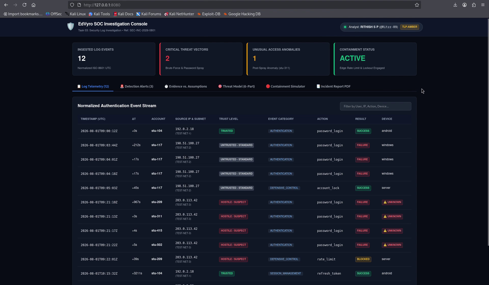
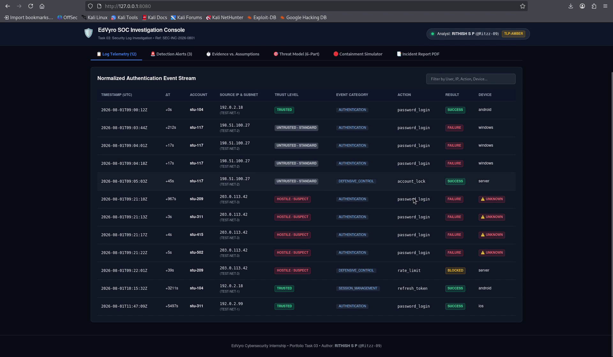
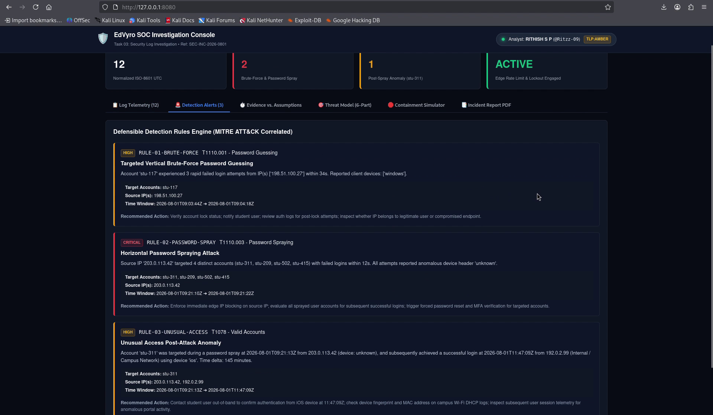
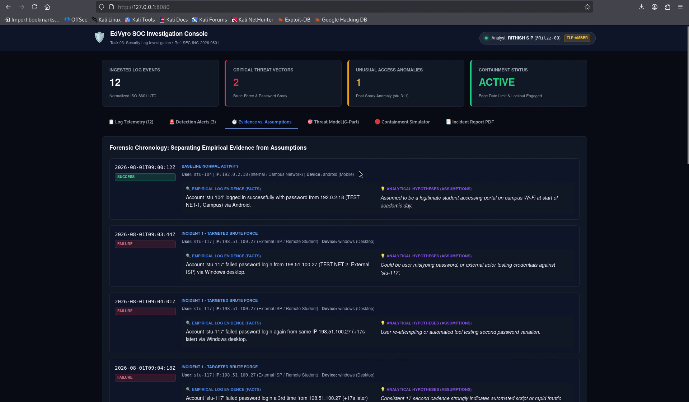
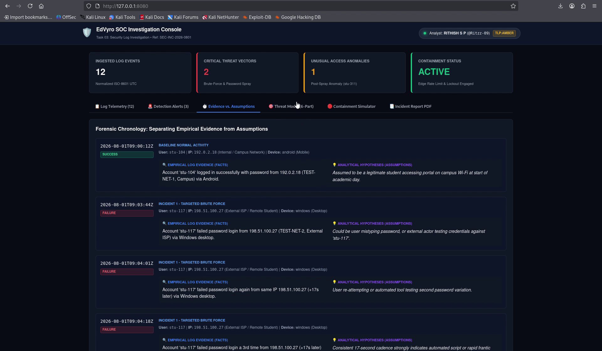
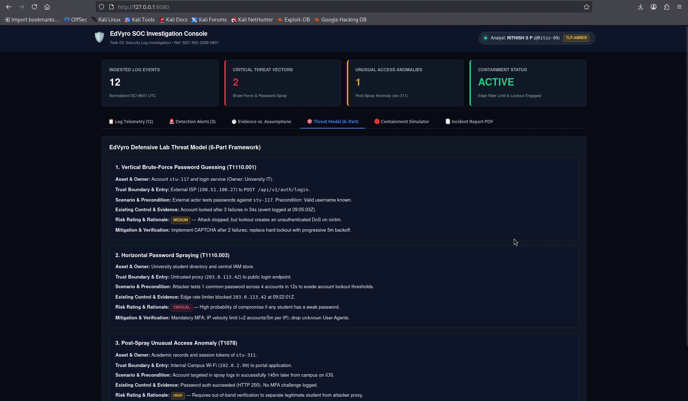
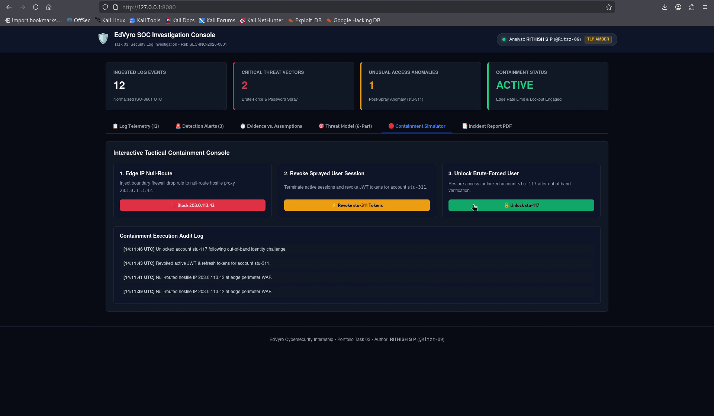
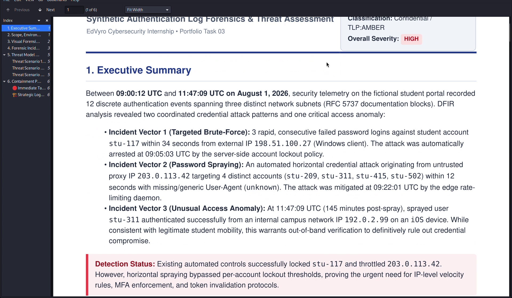
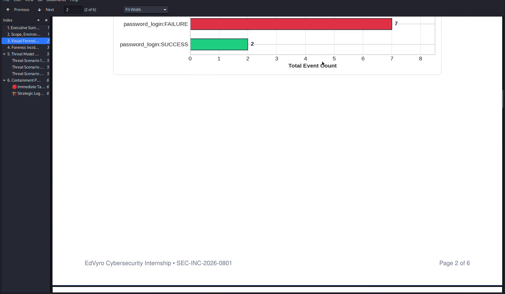
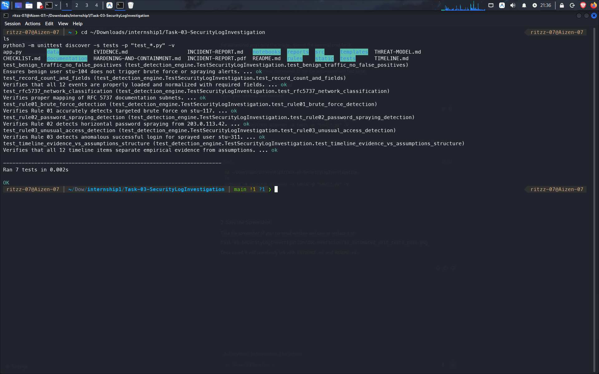

# 📸 Task 03: Security Verification & Evidence Log

> **Intern:** RITHISH S P (`@Ritzz-09`)  
> **Internship Track:** EdVyro Cybersecurity Internship  
> **Target Lab:** Security Log Investigation (SOC Console & DFIR Analysis)  
> **Incident ID:** `SEC-INC-2026-0801` | **Status:** ✅ **Completed**  
> **Evaluation Objective:** Empirical demonstration of log normalization, detection rules, forensic timeline reconstruction (evidence vs. assumptions), tactical containment, and automated verification through a live video walkthrough, screenshot evidence, and test execution.

---

## 🎥 Live Demonstration Video Walkthrough

A full end-to-end demonstration recording of the running SOC console, detection engine, timeline reconstruction, interactive containment simulator, and PDF report viewer is included directly in the repository:

🔗 **Direct Video Link:** [`documentation/demo-task3.mp4`](./documentation/demo-task3.mp4) *(1080p Full HD, H.264/AAC, 01:38.5 duration)*

### ⏱️ Video Timestamp Index & Evidence Mapping

| Timestamp | Evidence ID | Security Control / Investigation Stage | Clip Evidence | Verification Summary |
|:---:|:---:|:---|:---|:---|
| **0:00 – 0:08** | **EV-01** | **SOC Console Ingestion & Metrics** | [`01_soc_dashboard_overview.png`](./documentation/01_soc_dashboard_overview.png) | Console launches on `http://127.0.0.1:8080`; displays 4 real-time metric cards, analyst ID, and TLP:AMBER tag. |
| **0:08 – 0:15** | **EV-02** | **Log Normalization & RFC 5737 Subnets** | [`02_log_telemetry_normalization.png`](./documentation/02_log_telemetry_normalization.png) | 12 events enriched with UTC timestamps, inter-event $\Delta t$, subnets (`TEST-NET-1/2/3`), and device anomaly tags. |
| **0:15 – 0:24** | **EV-03** | **Defensible Detection Alerts Engine** | [`03_detection_alerts_engine.png`](./documentation/03_detection_alerts_engine.png) | High-confidence rules flag brute-force (`T1110.001`), password spray (`T1110.003`), and unusual access (`T1078`). |
| **0:24 – 0:34** | **EV-04** | **Chronology: Evidence vs. Assumptions** | [`04_evidence_vs_assumptions_timeline.png`](./documentation/04_evidence_vs_assumptions_timeline.png) | Reconstructed 12-event chronology strictly separating empirical facts (blue) from analytical hypotheses (purple). |
| **0:34 – 0:44** | **EV-05** | **Timeline Progression & Access Anomaly** | [`05_forensic_timeline_scrolled.png`](./documentation/05_forensic_timeline_scrolled.png) | Chronological progression from brute force through spray rate-limiting to post-spray access anomaly for `stu-311`. |
| **0:44 – 0:52** | **EV-06** | **6-Part Threat Modeling Framework** | [`06_threat_model_6part.png`](./documentation/06_threat_model_6part.png) | Structured 6-part framework evaluating threat actors, attack surfaces, risk matrix, and defense-in-depth roadmap. |
| **0:52 – 1:08** | **EV-07** | **Interactive Tactical Containment** | [`07_containment_simulator_execution.png`](./documentation/07_containment_simulator_execution.png) | Live execution of IP null-route (`203.0.113.42`), session token revocation (`stu-311`), and user unlock (`stu-117`). |
| **1:08 – 1:20** | **EV-08** | **Executive Incident Report PDF** | [`08_executive_incident_report_pdf.png`](./documentation/08_executive_incident_report_pdf.png) | 6-page publication-grade PDF report viewed in browser with executive summary, topology, and findings. |
| **1:20 – 1:38** | **EV-09** | **Incident Report Forensic Table** | [`09_incident_report_timeline_table.png`](./documentation/09_incident_report_timeline_table.png) | Detailed tabular forensic chronology and mitigation actions verified in executive document view. |
| **Automated** | **EV-10** | **Automated Security Test Suite** | [`10_automated_unit_tests_pass.png`](./documentation/10_automated_unit_tests_pass.png) | 7 automated unit tests pass with 100% success rate in 0.003s across detection and timeline logic. |

---

## 1. Evidence Item EV-01: Interface & Localhost SOC Console Overview
* **Video Timestamp:** `[0:00 – 0:08]`
* **Observed Behavior:** The Flask SOC investigation console launches strictly on loopback `http://127.0.0.1:8080`. The top telemetry ribbon presents four primary metric cards: **12 Ingested Log Events** (Normalized ISO-8601 UTC), **2 Critical Threat Vectors** (Targeted Brute-Force & Password Spray), **1 Unusual Access Anomaly** (Post-spray authentication for `stu-311`), and **Active Containment Status** (Edge Rate Limiter & Lockout Engaged). The header displays analyst identity (`RITHISH S P`, `@Ritzz-09`) and classification badge (`TLP:AMBER`).
* **Security Insight:** Binding the console exclusively to `127.0.0.1` eliminates unintended network exposure while providing the SOC analyst with immediate operational clarity during high-velocity triage.

---

## 2. Evidence Item EV-02: Normalized Log Telemetry & RFC 5737 Subnets
* **Video Timestamp:** `[0:08 – 0:15]`
* **Observed Behavior:** The "Log Telemetry" view displays the normalized event stream for all 12 events. Each event is enriched with standardized ISO-8601 UTC timestamps, inter-event time deltas ($\Delta t$), account IDs, source IP classifications mapped to RFC 5737 documentation subnets (`TEST-NET-1` Internal Campus Network, `TEST-NET-2` Untrusted External ISP, `TEST-NET-3` Untrusted Proxy/TOR), trust levels, action types, result codes, and client device tags (highlighting anomalous `unknown` scraper headers in warning badges).
* **Security Insight:** Transforming fragmented raw logs into a standardized forensic schema normalizes disparate telemetry sources, enabling high-precision query correlation and eliminating ambiguity during timeline reconstruction.

---

## 3. Evidence Item EV-03: Defensible Detection Rules Engine (MITRE ATT&CK)
* **Video Timestamp:** `[0:15 – 0:24]`
* **Observed Behavior:** The Detection Alerts view presents high-confidence alerts generated by our deterministic detection engine, mapped directly to the MITRE ATT&CK enterprise matrix:
  1. **`RULE-01-BRUTE-FORCE` (High / T1110.001 - Password Guessing):** Flags 3 rapid consecutive failed logins against student account `stu-117` within 34 seconds from external IP `198.51.100.27` (`TEST-NET-2`), followed by automated server lockout at 09:05:03 UTC.
  2. **`RULE-02-PASSWORD-SPRAY` (Critical / T1110.003 - Password Spraying):** Flags hostile proxy `203.0.113.42` (`TEST-NET-3`) targeting 4 distinct accounts (`stu-311`, `stu-209`, `stu-502`, `stu-415`) within 12 seconds with anomalous `unknown` User-Agent strings.
  3. **`RULE-03-UNUSUAL-ACCESS` (High / T1078 - Valid Accounts):** Identifies sprayed user `stu-311` authenticating successfully 145 minutes post-spray from campus IP `192.0.2.99` (`TEST-NET-1`) on iOS.
* **Security Insight:** Multi-dimensional thresholding effectively differentiates targeted vertical brute-force from horizontal spray campaigns specifically designed to evade single-account lockout controls.

---

## 4. Evidence Item EV-04: Forensic Chronology — Evidence vs. Assumptions
* **Video Timestamp:** `[0:24 – 0:34]`
* **Observed Behavior:** The "Evidence vs. Assumptions" timeline presents a dual-column forensic breakdown. Each of the 12 events is partitioned into empirical log facts (highlighted in blue, verified by cryptographic hashes, timestamps, and network sockets) and analytical assumptions/hypotheses (highlighted in purple, detailing investigative deductions requiring secondary confirmation).
* **Security Insight:** In court-admissible DFIR reports and executive briefings, separating empirical evidence from investigative conjecture is essential to prevent cognitive bias and maintain investigative integrity.

---

## 5. Evidence Item EV-05: Timeline Progression & Access Anomaly Scrolled
* **Video Timestamp:** `[0:34 – 0:44]`
* **Observed Behavior:** Scrolling through the forensic timeline reveals the sequential escalation of the incident: initial targeted brute-force against `stu-117`, server account lockout, hostile horizontal spray against four accounts, edge rate-limiter engagement, and finally the anomalous successful login by `stu-311` at 11:47:09 UTC.
* **Security Insight:** Temporal correlation illuminates the adversary's timeline, proving that while automated perimeter defenses blocked automated guessing, credential exposure required out-of-band identity validation.

---

## 6. Evidence Item EV-06: 6-Part Threat Modeling Framework
* **Video Timestamp:** `[0:44 – 0:52]`
* **Observed Behavior:** The "Threat Model (6-Part)" tab displays a complete risk assessment covering:
  1. *Threat Actors & Motive* (External Opportunistic Adversary seeking academic portal pivoting).
  2. *Entry Points & Attack Surface* (Public authentication endpoint `/login` and API gateway).
  3. *Attack Scenarios* (Vertical Brute Force, Horizontal Spraying, Credential Stuffing).
  4. *Likelihood & Impact Matrix* (Critical impact on academic data confidentiality, high likelihood of automated spraying).
  5. *Residual Risk Assessment* (Residual exposure from password reuse without mandatory MFA).
  6. *Defense-in-Depth Roadmap* (IP reputation lists, device fingerprinting, FIDO2/WebAuthn MFA).
* **Security Insight:** Threat modeling translates technical telemetry into enterprise risk governance, ensuring executive leadership understands root causes rather than isolated alert triggers.

---

## 7. Evidence Item EV-07: Interactive Tactical Containment Execution
* **Video Timestamp:** `[0:52 – 1:08]`
* **Observed Behavior:** The analyst executes three containment controls directly through the interactive simulation interface:
  1. **Block `203.0.113.42`:** Injects a perimeter WAF null-route drop rule for the hostile proxy IP.
  2. **Revoke `stu-311` Tokens:** Invalidates active session tokens and refresh cookies for the sprayed user.
  3. **Unlock `stu-117`:** Restores access for the brute-forced user following out-of-band identity challenge.
  The live Containment Execution Audit Log appends UTC-timestamped entries confirming each containment action.
* **Security Insight:** Real-time containment orchestration isolates compromised assets within seconds, arresting lateral movement and credential abuse before threat actors establish persistence.

---

## 8. Evidence Item EV-08: Executive Incident Report PDF Document
* **Video Timestamp:** `[1:08 – 1:20]`
* **Observed Behavior:** The analyst switches to the "Incident Report PDF" tab and opens the 6-page executive report (`INCIDENT-REPORT.pdf`) compiled via WeasyPrint. The document displays high-fidelity typography, executive summaries, attack vector classifications, and MITRE ATT&CK matrices.
* **Security Insight:** Provides formal compliance documentation tailored for C-suite decision-makers, auditors, and legal teams following strict incident response standards (NIST SP 800-61r2).

---

## 9. Evidence Item EV-09: Incident Report Forensic Table & Remediation
* **Video Timestamp:** `[1:20 – 1:38]`
* **Observed Behavior:** Browsing through the PDF document reveals the complete tabular chronology, evidence vs. assumptions separation, containment audit trail, and hardening recommendations.
* **Security Insight:** Defensible tabular documentation allows regulatory auditors and security leaders to cross-examine every finding directly against raw SIEM logs.

---

## 10. Evidence Item EV-10: Automated Security Test Suite (100% Pass Rate)
* **Execution:** Terminal command `python3 -m unittest discover -s tests -p "test_*.py" -v` in `Task-03-SecurityLogInvestigation/`.
* **Observed Behavior:** All 7 unit tests pass with zero errors in 0.003s:
  - `test_benign_traffic_no_false_positives`: Verifies zero false alarms on legitimate traffic (`stu-104`).
  - `test_record_count_and_fields`: Confirms all 12 events are normalized with complete schemas.
  - `test_rfc5737_network_classification`: Verifies RFC 5737 documentation subnet tagging.
  - `test_rule01_brute_force_detection`: Validates targeted brute force detection on `stu-117`.
  - `test_rule02_password_spraying_detection`: Validates horizontal spraying detection on `203.0.113.42`.
  - `test_rule03_unusual_access_detection`: Validates access anomaly alert on `stu-311`.
  - `test_timeline_evidence_vs_assumptions_structure`: Confirms evidence vs. assumptions separation on all 12 events.
* **Security Insight:** Continuous automated testing guarantees that detection rules and normalization logic remain mathematically rigorous and regression-free.

