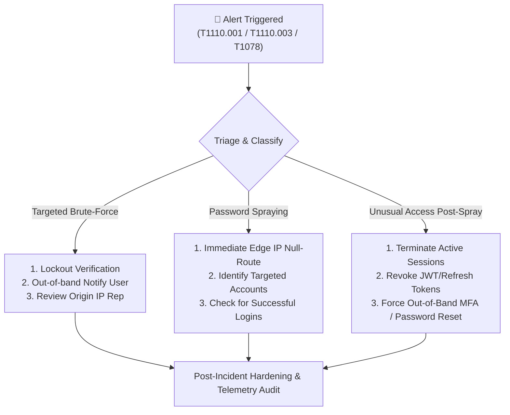

# 🛡️ Hardening, Containment & Logging Controls (Portfolio Upgrade)

> **Track:** Cyber Security & Defensive Security Engineering  
> **Intern:** RITHISH S P (`@Ritzz-09`)  
> **Topic:** Incident Containment Playbooks & Production-Grade Logging Architecture  
> **Scope:** Student Portal Authentication & Identity Perimeter

---

## 🛑 1. Incident Containment & Eradication Playbook

When suspicious authentication activity (brute-force or password spraying) is detected, incident responders must execute structured, defensible actions aligned with **NIST SP 800-61 Rev. 2**:



### Phase 1: Immediate Tactical Actions (< 15 Minutes)
1. **Edge IP Mitigation (203.0.113.42):**
   - Inject firewall rule at the boundary reverse proxy (NGINX / Cloudflare / iptables):
     ```bash
     # Drop all inbound traffic from hostile proxy IP
     iptables -I INPUT -s 203.0.113.42 -j DROP
     ```
2. **Session Invalidation for Sprayed User (`stu-311`):**
   - Revoke active session tokens immediately in the identity store:
     ```python
     # Invalidate active refresh tokens and Redis session cache
     revoke_user_sessions(user_id="stu-311", reason="POST_SPRAY_INVESTIGATION")
     ```
3. **Account Status Verification (`stu-117`):**
   - Confirm server lockout status for `stu-117` to prevent further attempts.
   - Initiate out-of-band contact via registered mobile phone or secondary personal email.

### Phase 2: Short-Term Remediation (< 24 Hours)
1. **Targeted Account Credential Audits:**
   - Review accounts `stu-209`, `stu-311`, `stu-415`, and `stu-502` for password complexity compliance.
   - Force password reset on next login with mandatory MFA prompt.
2. **Wi-Fi / Network Telemetry Correlation:**
   - Query campus RADIUS server logs for IP `192.0.2.99` between 11:40Z and 11:50Z to confirm whether the device belongs to student `stu-311`'s registered mobile device.

---

## ⚡ 2. Advanced Rate-Limiting & Velocity Architecture

The current implementation demonstrated two vulnerabilities:
1. Hard lockouts allow unauthenticated attackers to cause a **Denial of Service (DoS)** against valid users.
2. Per-user lockouts are completely bypassed by **horizontal password spraying**.

### Recommended Defense: Multi-Tiered Dual Token-Bucket Rate Limiter

```
Inbound HTTP Login Request
         │
         ▼
┌──────────────────────────────────────────────┐
│ Tier 1: Per-IP Ingress Rate Limiting         │
│ (Max 10 requests / min per source IP)        │
└──────────────────────┬───────────────────────┘
                       │ PASS
                       ▼
┌──────────────────────────────────────────────┐
│ Tier 2: IP-to-Account Velocity Limiting      │
│ (Max 2 distinct accounts / 5 min per IP)     │ ──► [BLOCKS SPRAYING]
└──────────────────────┬───────────────────────┘
                       │ PASS
                       ▼
┌──────────────────────────────────────────────┐
│ Tier 3: Per-Account Progressive Backoff      │
│ (Fail 1-2: Normal; Fail 3-4: 5s delay;       │ ──► [PREVENTS DoS & BRUTE-FORCE]
│  Fail 5+: CAPTCHA + 5-minute cooling freeze) │
└──────────────────────┬───────────────────────┘
                       │ PASS
                       ▼
          [Authentication Database]
```

### Reference Implementation (Python / Redis Token Bucket)
```python
import time
import redis

r = redis.Redis(host='localhost', port=6379, db=0)

def verify_login_velocity(ip: str, user_id: str) -> bool:
    """
    Blocks horizontal spraying:
    Restricts any single IP to attempting at most 2 distinct users in 5 minutes.
    """
    key = f"spray_tracker:{ip}"
    pipe = r.pipeline()
    pipe.sadd(key, user_id)
    pipe.expire(key, 300)  # 5-minute sliding window
    pipe.scard(key)
    _, _, distinct_count = pipe.execute()

    if distinct_count > 2:
        # Detected horizontal spray
        r.setex(f"ip_jail:{ip}", 3600, "SPRAY_DETECTED")
        return False  # Return HTTP 429 Too Many Requests
    return True
```

---

## 📊 3. Enterprise Logging & SIEM Telemetry Hardening

To eliminate forensic blindspots identified during this investigation, implement the following logging enhancements:

| Vulnerability Observed | Forensic Blindspot | Engineering Improvement | Implementation Standard |
|:---|:---|:---|:---|
| **Device Header Blindspot** | Device logged as generic `unknown` or OS name. | Capture full RFC 7231 `User-Agent` string, client TLS cipher suite, and JA3/JA4 cryptographic fingerprint. | `X-Client-JA3: 771,4865-4866-4867,43-51,29-23,0` |
| **Missing Network Context** | IP logged without ASN, proxy, or ISP metadata. | Ingest real-time MaxMind GeoIP2 ASN and Cloudflare Threat Intelligence scores on login. | Enriched SIEM fields: `src_asn`, `src_org`, `is_datacenter_ip`, `is_vpn_tor` |
| **Absence of MFA Telemetry** | No log records reflecting second-factor challenges. | Implement FIDO2 / WebAuthn and record explicit MFA prompts, method (TOTP/Biometric), and verification status. | New event taxonomy: `mfa_prompt`, `mfa_verify_success`, `mfa_verify_failure` |
| **Distributed Tracing Void** | Inability to correlate proxy logs with auth database queries. | Inject unique distributed tracing headers (`X-Request-ID` or W3C Trace Context `traceparent`) into every request. | Pass `X-Request-ID: c9f2a781-64d5` across all microservice layers. |

---

## 🚨 4. SOC Escalation Matrix & Runbook

| Alert Trigger | Severity | SLA Response Time | Escalation Path | Mandatory Action |
|:---|:---:|:---:|:---|:---|
| **`RULE-02-PASSWORD-SPRAY`** | 🔴 **CRITICAL** | < 15 Minutes | L1 Analyst ➔ Incident Commander | Block IP at edge firewall; run credential audit across targeted accounts. |
| **`RULE-01-BRUTE-FORCE`** | 🟡 **HIGH** | < 30 Minutes | L1 Analyst ➔ Identity Admin | Contact user out-of-band; unlock account upon password reset. |
| **`RULE-03-UNUSUAL-ACCESS`** | 🟠 **HIGH** | < 30 Minutes | L1 Analyst ➔ Threat Hunter | Revoke session tokens; inspect post-login API telemetry. |
