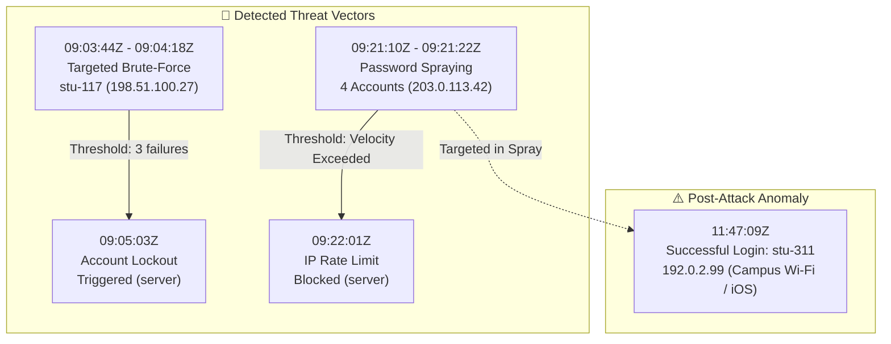

# 🔍 Task 03: Security Log Investigation & DFIR Analysis

> **Track:** Cyber Security & Defensive Security Engineering  
> **Intern:** RITHISH S P (`@Ritzz-09`)  
> **Repository:** [https://github.com/Ritzz-09/EdVyro-Internship](https://github.com/Ritzz-09/EdVyro-Internship)  
> **Incident ID:** `SEC-INC-2026-0801` | **Status:** ✅ **Completed**

---

## 🎯 Executive Overview
This laboratory investigation focuses on forensic analysis of a synthetic student portal authentication log (`authentication-log-sample.csv`) containing 12 events. The objective is to turn raw event records into **defensible detection findings**, reconstruct a verifiable **incident timeline** separating empirical evidence from analytical assumptions, define production-ready **SIEM detection rules**, and deliver an executive **Incident Report PDF**.

---

## 📋 Passing Checklist Verification

| Requirement | Description | Status | Evidence Link |
|:---|:---|:---:|:---|
| **1. Normalization** | Normalize timestamps (UTC ISO-8601), IPs (RFC 5737 networks), accounts, action taxonomies, and outcome states. | ✅ Pass | [`data/normalized_authentication_log.csv`](./data/normalized_authentication_log.csv)<br>[`src/normalizer.py`](./src/normalizer.py) |
| **2. Detection Rules** | Define defensible rules for vertical brute force, horizontal spraying, and unusual access anomalies. | ✅ Pass | [`src/detection_engine.py`](./src/detection_engine.py)<br>[`rules/sigma_rules.yml`](./rules/sigma_rules.yml)<br>[`rules/siem_queries.spl`](./rules/siem_queries.spl) |
| **3. Forensic Timeline** | Reconstruct incident sequence while strictly separating empirical log evidence from analytical assumptions. | ✅ Pass | [`TIMELINE.md`](./TIMELINE.md)<br>[`src/timeline_builder.py`](./src/timeline_builder.py) |
| **4. Deliverables** | Provide interactive Jupyter notebook, normalized data, and executive Incident Report PDF. | ✅ Pass | [`notebooks/security_investigation.ipynb`](./notebooks/security_investigation.ipynb)<br>[`INCIDENT-REPORT.pdf`](./INCIDENT-REPORT.pdf) |
| **⭐ Portfolio Upgrade** | Actionable containment playbooks, rate-limiting architecture, and SIEM telemetry improvements. | ✅ Pass | [`HARDENING-AND-CONTAINMENT.md`](./HARDENING-AND-CONTAINMENT.md) |

---

## 🔬 Incident Findings Summary



### 1. Targeted Vertical Brute-Force (stu-117)
- **Source IP:** `198.51.100.27` (TEST-NET-2, External ISP)
- **Cadence:** 3 consecutive failures spaced by exactly 17 seconds (total span: 34 seconds).
- **Defensive Outcome:** Server successfully enforced `account_lock` at 09:05:03Z.
- **Risk Assessment:** Threat contained; potential unauthenticated Denial of Service (DoS) condition on victim.

### 2. Horizontal Password Spraying (Multi-Account)
- **Source IP:** `203.0.113.42` (TEST-NET-3, Hostile Proxy / Datacenter)
- **Cadence:** 4 distinct student accounts (`stu-209`, `stu-311`, `stu-415`, `stu-502`) attacked within 12 seconds with anomalous `unknown` device header.
- **Defensive Outcome:** Server rate-limiting daemon blocked subsequent requests at 09:22:01Z.
- **Risk Assessment:** High velocity attack aimed at circumventing per-account lockout thresholds.

### 3. Post-Spray Unusual Access Anomaly (stu-311)
- **Event:** At 11:47:09Z (145 minutes post-spray), sprayed user `stu-311` authenticated successfully from campus network `192.0.2.99` on an `iOS` device.
- **Evidentiary Rigor:** We differentiate **Hypothesis A** (benign student arriving on campus) from **Hypothesis B** (credential compromise via out-of-band credential reuse or internal proxy). Flagged for mandatory out-of-band verification.

---

## 📁 Repository Structure

```
Task-03-SecurityLogInvestigation/
├── data/
│   ├── raw_authentication_log.csv            # Original synthetic dataset (12 events)
│   └── normalized_authentication_log.csv     # Enriched ISO-8601 UTC & RFC 5737 tagged logs
├── documentation/
│   ├── demo-task3.mp4                        # Full HD demo walkthrough video (01:38.5)
│   ├── 01_soc_dashboard_overview.png         # SOC Console launch & real-time metrics
│   ├── 02_log_telemetry_normalization.png    # Normalized ISO-8601 UTC & RFC 5737 subnets
│   ├── 03_detection_alerts_engine.png        # MITRE ATT&CK alert rules (T1110 & T1078)
│   ├── 04_evidence_vs_assumptions_timeline.png# Dual-column facts vs. hypotheses timeline
│   ├── 05_forensic_timeline_scrolled.png     # Access anomaly sequence & causal flow
│   ├── 06_threat_model_6part.png             # 6-part threat modeling risk matrix
│   ├── 07_containment_simulator_execution.png# Interactive IP blocking & token revocation
│   ├── 08_executive_incident_report_pdf.png  # 6-page WeasyPrint Incident Report PDF
│   ├── 09_incident_report_timeline_table.png # Detailed forensic chronology table
│   └── 10_automated_unit_tests_pass.png      # 7 automated unit tests passing (100%)
├── notebooks/
│   └── security_investigation.ipynb          # Interactive Jupyter DFIR analysis notebook
├── src/
│   ├── normalizer.py                         # ETL normalization and IP classification engine
│   ├── detection_engine.py                   # Modular rule evaluator for T1110 & T1078
│   ├── timeline_builder.py                   # Chronological evidence vs assumptions compiler
│   ├── create_notebook.py                    # Programmatic Jupyter notebook generator
│   └── generate_report_pdf.py                # Publication-grade WeasyPrint PDF compiler
├── rules/
│   ├── sigma_rules.yml                       # Industry-standard Sigma detection definitions
│   └── siem_queries.spl                      # Splunk SPL and SQL hunting queries
├── tests/
│   └── test_detection_engine.py              # Automated unit tests (100% passing)
├── reports/
│   ├── INCIDENT-REPORT.pdf                   # 6-page publication-grade PDF report
│   └── assets/                               # High-res forensic matplotlib charts
├── INCIDENT-REPORT.pdf                       # Root-accessible executive PDF report
├── INCIDENT-REPORT.md                        # Complete Markdown incident report
├── TIMELINE.md                               # Evidence vs. Assumptions matrix
├── THREAT-MODEL.md                           # 6-part defensive lab threat model
├── HARDENING-AND-CONTAINMENT.md              # Incident containment & logging improvements
├── EVIDENCE.md                               # Video demonstration script & evidence log
├── CHECKLIST.md                              # Passing checklist verification log
└── README.md                                 # This documentation file
```

---

## 🚀 How to Run the Investigation Locally

### 1. Run Automated Security Unit Tests
```bash
cd Task-03-SecurityLogInvestigation
python3 -m unittest discover -s tests -p "test_*.py" -v
```

### 2. Run the Data Normalizer & Detection Engine
```bash
# Normalize raw authentication logs
python3 src/normalizer.py

# Execute detection engine rules
python3 src/detection_engine.py

# Reconstruct forensic timeline
python3 src/timeline_builder.py
```

### 3. Re-generate the Executive Incident Report PDF
```bash
python3 src/generate_report_pdf.py
```

### 4. Launch the Interactive SOC Dashboard Instance
```bash
python3 app.py
```
Open your browser to: **`http://127.0.0.1:8080`**

### 5. Open the Jupyter Notebook
```bash
jupyter notebook notebooks/security_investigation.ipynb
```

---

## 🛡️ Deliverables Overview
- 📘 [`INCIDENT-REPORT.pdf`](./INCIDENT-REPORT.pdf) — Complete 6-page executive report with charts, threat models, and sign-offs.
- 📝 [`INCIDENT-REPORT.md`](./INCIDENT-REPORT.md) — Text version of the incident investigation.
- ⏱️ [`TIMELINE.md`](./TIMELINE.md) — Detailed timeline separating log evidence from analytical assumptions.
- 🎯 [`THREAT-MODEL.md`](./THREAT-MODEL.md) — 6-part threat model based on the EdVyro Defensive Lab brief.
- 🔒 [`HARDENING-AND-CONTAINMENT.md`](./HARDENING-AND-CONTAINMENT.md) — Containment playbooks and telemetry upgrades.
- 📸 [`EVIDENCE.md`](./EVIDENCE.md) — Full video demonstration script, timestamp index, and screenshot mapping.
