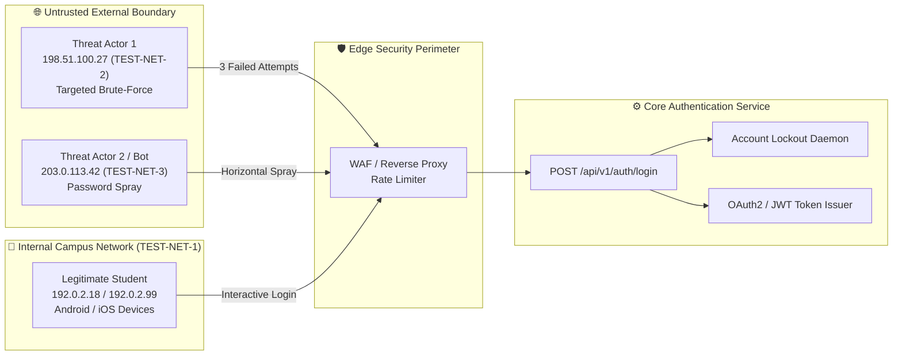

# 🎯 Defensive Lab Threat Model: Authentication Services

> **Track:** Cyber Security & Defensive Security Engineering  
> **Institution:** EdVyro Cybersecurity Internship  
> **Scope:** Student Information System (SIS) Authentication Service  
> **Environment:** Fictional student portal running in an isolated laboratory environment  
> **Framework:** EdVyro Defensive Lab Threat-Model Template (6-part schema)

---

## 🏛️ Threat Model Architecture Overview

---

## 📋 Evaluated Threat Scenarios

---

### Threat Scenario 1: Vertical Brute-Force Password Guessing (`T1110.001`)

#### 1. Asset and Owner
- **Asset:** Student credentials, session tokens, and portal profile for user `stu-117`.
- **Owner:** Student user `stu-117` and University IT Security Operations.

#### 2. Trust Boundary and Entry Point
- **Trust Boundary:** External untrusted internet to student portal ingress.
- **Entry Point:** Public authentication endpoint (`POST /api/v1/auth/login`).
- **Observed Origin:** `198.51.100.27` (`TEST-NET-2`, commercial ISP).

#### 3. Threat Scenario and Precondition
- **Threat Scenario:** An external adversary performs high-frequency dictionary or credential-guessing attacks against account `stu-117` in an attempt to discover the user's password.
- **Precondition:** Attacker possesses a valid student username/identifier (`stu-117`) via directory harvesting, social engineering, or public campus leaks.

#### 4. Existing Control and Evidence
- **Existing Control:** Server-side account lockout policy enforcing account suspension after 3 failed login attempts.
- **Empirical Evidence:**
  - `2026-08-01T09:03:44Z`: Failure 1 (Windows, `198.51.100.27`)
  - `2026-08-01T09:04:01Z`: Failure 2 (+17s delta)
  - `2026-08-01T09:04:18Z`: Failure 3 (+17s delta)
  - `2026-08-01T09:05:03Z`: `account_lock` event recorded by `server`.

#### 5. Risk Rating with Rationale
- **Risk Rating:** 🟡 **MEDIUM (Residual)**
- **Rationale:** The lockout control prevented unauthorized access and credential compromise. However, the existing implementation creates an unauthenticated **Denial of Service (DoS)** vulnerability: any malicious actor can permanently lock an arbitrary student out of their account simply by submitting 3 incorrect passwords.

#### 6. Recommended Mitigation and Verification Step
- **Recommended Mitigation:**
  1. Replace permanent hard lockout with an exponential backoff cooling period (e.g., 5-minute freeze after 5 failures).
  2. Implement an adaptive CAPTCHA / Proof-of-Work challenge upon the 2nd failure.
  3. Send an instant out-of-band security alert to the student's registered secondary email/SMS.
- **Verification Step:** Simulate 3 consecutive failed logins from an isolated terminal; verify CAPTCHA presentation and temporary cooling timer; ensure legitimate student can still authenticate via SMS/email challenge.

---

### Threat Scenario 2: Horizontal Password Spraying (`T1110.003`)

#### 1. Asset and Owner
- **Asset:** Directory of student accounts, campus identity store, and university computing resources.
- **Owner:** Central University Identity & Access Management (IAM) and Campus Registrar.

#### 2. Trust Boundary and Entry Point
- **Trust Boundary:** Untrusted proxy/cloud hosting perimeter to portal authentication service.
- **Entry Point:** Public authentication API endpoint (`POST /api/v1/auth/login`).
- **Observed Origin:** `203.0.113.42` (`TEST-NET-3`, external hosting/proxy).

#### 3. Threat Scenario and Precondition
- **Threat Scenario:** An attacker scripts a password spray attack, testing a small number of common passwords (e.g., `Spring2026!`, `Welcome123`) horizontally across multiple student IDs (`stu-209`, `stu-311`, `stu-415`, `stu-502`) to evade individual account lockout counters.
- **Precondition:** Attacker obtained a student roster or user enumeration list; system lacks IP-level request velocity controls.

#### 4. Existing Control and Evidence
- **Existing Control:** Server-level rate limiting daemon monitoring IP request frequency.
- **Empirical Evidence:**
  - `09:21:10Z`: `stu-209` failed login from `203.0.113.42` (device: `unknown`)
  - `09:21:13Z`: `stu-311` failed login (+3s)
  - `09:21:17Z`: `stu-415` failed login (+4s)
  - `09:21:22Z`: `stu-502` failed login (+5s)
  - `09:22:01Z`: `rate_limit` blocked event enforced on `203.0.113.42` (+39s later).

#### 5. Risk Rating with Rationale
- **Risk Rating:** 🔴 **CRITICAL**
- **Rationale:** Password spraying is one of the most effective initial access techniques against educational institutions. Although the server rate limiter eventually triggered, 4 accounts were targeted across 12 seconds before enforcement occurred. If even one user had a weak password, compromise would have been achieved before the block.

#### 6. Recommended Mitigation and Verification Step
- **Recommended Mitigation:**
  1. Enforce mandatory Multi-Factor Authentication (MFA) via FIDO2 / WebAuthn or TOTP.
  2. Implement IP velocity rules in the reverse proxy / WAF: limit any IP to no more than 2 distinct user authentication attempts per 5 minutes.
  3. Drop all HTTP login requests featuring missing or `unknown` User-Agent strings.
- **Verification Step:** Run automated spray simulation tool; verify that request 3 targeting a different account triggers HTTP 429 and temporary IP jail within < 1 second.

---

### Threat Scenario 3: Anomalous Post-Spray Access / Account Takeover (`T1078`)

#### 1. Asset and Owner
- **Asset:** Academic transcripts, personal identifiable information (PII), and financial records of student `stu-311`.
- **Owner:** Student user `stu-311` and Campus Registrar.

#### 2. Trust Boundary and Entry Point
- **Trust Boundary:** Campus Wi-Fi network edge (TEST-NET-1) to web portal application layer.
- **Entry Point:** Web login interface (`POST /api/v1/auth/login`).
- **Observed Origin:** `192.0.2.99` (`TEST-NET-1`, internal campus network).

#### 3. Threat Scenario and Precondition
- **Threat Scenario:** Account `stu-311` was targeted in the 09:21:13Z password spray. At 11:47:09Z (145 minutes later), a successful login occurred from campus IP `192.0.2.99` on an `iOS` client.
  - *Hypothesis A (Benign):* Legitimate student arrived on campus and logged in from their iPhone.
  - *Hypothesis B (Compromised):* Attacker obtained credentials out-of-band (or via credential stuffing) and accessed the portal using a compromised on-campus device or VPN.
- **Precondition:** Valid credentials for `stu-311` submitted to portal.

#### 4. Existing Control and Evidence
- **Existing Control:** Standard username and password validation.
- **Empirical Evidence:**
  - `09:21:13Z`: Spray attempt failed for `stu-311` from `203.0.113.42` (`unknown` client).
  - `11:47:09Z`: Successful password login for `stu-311` from `192.0.2.99` (`ios` client).
  - Absence of MFA challenge telemetry.

#### 5. Risk Rating with Rationale
- **Risk Rating:** 🟠 **HIGH**
- **Rationale:** In defensible SOC operations, an account targeted during an active adversary campaign that subsequently succeeds from a different device must be treated as an anomaly until out-of-band user verification is completed.

#### 6. Recommended Mitigation and Verification Step
- **Recommended Mitigation:**
  1. Revoke active session tokens for `stu-311` and force password rotation.
  2. Conduct out-of-band verification with the student to confirm ownership of the iOS device.
  3. Correlate IP `192.0.2.99` against campus Wi-Fi RADIUS/DHCP logs to identify the associated MAC address and hardware model.
- **Verification Step:** Review RADIUS authentication logs for user `stu-311`; inspect post-11:47:09Z access logs for unusual data exfiltration or grade tampering.
